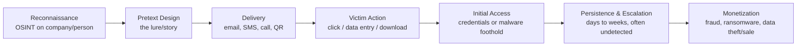

# How a Phishing Attack Actually Works

A phishing attack is rarely a single, isolated email. In most real incidents — including the large-scale breaches described elsewhere in this repository — phishing is the **opening move** of a much longer attack chain. Understanding that full chain is essential, because it explains why a single click can sometimes cascade into a company-wide disaster weeks later.

---

## Stage 1: Reconnaissance

Before a single email is sent, attackers research their target. For a mass campaign, this can be as simple as buying a leaked list of email addresses. For a targeted spear-phishing or whaling attack, it's far more deliberate:

- Scraping LinkedIn for employee names, job titles, and reporting structures.
- Reading a company's press releases, job postings, and public financial filings to understand internal terminology, vendors, and current projects.
- Checking data-breach dumps for previously leaked passwords or personal details belonging to employees.
- Identifying who handles payments, IT administration, or HR — the roles most valuable to compromise.

This stage is also known as **open-source intelligence gathering (OSINT)**, and it's why attacks can feel eerily specific even though the attacker has never had any direct contact with the company before.

---

## Stage 2: Pretext design

With research in hand, the attacker builds the "story" — the specific scenario the message will use to justify its request. A good pretext is tailored to:

- **The role of the target** (a finance employee gets an invoice; an HR employee gets a resume; an executive gets a legal notice).
- **The current moment** (end of fiscal quarter, right after a company announcement, during a known software migration).
- **An emotional trigger** that discourages careful thinking — fear, urgency, authority, or curiosity (see the full breakdown in `05-what-phishing-exploits.md`).

This is the stage where modern AI tools have had the biggest impact: generating flawless, natural-sounding, localized text in seconds, removing almost all of the old warning signs like awkward grammar or stilted phrasing.

---

## Stage 3: Delivery

The message is sent through whichever channel the attacker believes has the best chance of reaching the target with the least resistance — email, SMS, a phone call, a QR code, or even a direct message on a collaboration platform like Slack or Teams. Attackers increasingly spoof internal-looking addresses or compromise a real but low-security account (a vendor, a former employee) to make the delivery channel itself look legitimate.

---

## Stage 4: The hook — getting the victim to act

This is the moment the entire attack is built around: convincing the target to click a link, open an attachment, or respond with the information requested. The destination is usually one of:

- A **fake login page** that is a pixel-perfect clone of a real portal (Microsoft 365, a bank, an internal VPN), capturing whatever username and password is typed in.
- A **malicious attachment** disguised as an invoice, resume, or shipping document, which silently installs malware when opened.
- A **direct reply request** with no link or file at all — just a conversational ask, as in classic Business Email Compromise.

---

## Stage 5: Initial access

If the victim entered credentials, the attacker now has a working login — often to a system that looks completely unremarkable from the outside, like email, a VPN, or a single business application. If the victim opened a malicious file, the attacker now has code running on that device, frequently through an **infostealer** — malware purpose-built to quietly harvest saved passwords, browser cookies, and authentication tokens from the compromised machine.

This is the critical turning point that too many people misunderstand: the initial click is almost never the full extent of the damage. It's a door being unlocked.

---

## Stage 6: Persistence and escalation (the quiet phase)

In many of the most damaging real-world breaches, attackers do **not** act immediately after gaining access. Instead, they quietly explore the network for days or even weeks — mapping out systems, identifying valuable data, and escalating from a low-level account to more powerful administrative privileges, all while trying to avoid detection. This is exactly what happened in the Change Healthcare case described in `02-why-phishing-matters.md`: attackers sat inside the network for roughly nine days, exfiltrating data, before finally deploying ransomware.

This quiet phase is also the best opportunity for a well-prepared organization to catch the intrusion — through anomaly detection, monitoring for unusual login locations or times, and rapid incident response — before the damage multiplies.

---

## Stage 7: Monetization

Finally, the attacker cashes in on the access they've built, typically through one or more of:

- **Direct financial fraud** — wiring company funds to attacker-controlled accounts (common in BEC).
- **Ransomware deployment** — encrypting critical systems and demanding payment to restore them.
- **Data theft and extortion** — stealing sensitive data and threatening to leak it publicly unless paid (often combined with ransomware in a "double extortion" model).
- **Selling access** — in the growing Ransomware-as-a-Service economy, some attackers specialize purely in gaining initial access and then selling that access to other criminal groups who carry out the final attack.

---

## Why this full chain matters for a defense strategy

Most security awareness training focuses entirely on Stage 4 — "don't click the link." That's important, but it's only one checkpoint in a seven-stage chain. A mature security program builds defenses at *multiple* stages simultaneously:

| Stage | Defense opportunity |
|---|---|
| Reconnaissance | Limit public exposure of sensitive org-chart and role details |
| Delivery | Email filtering, SPF/DKIM/DMARC, anti-spoofing controls |
| The hook | Employee awareness training, simulated phishing exercises |
| Initial access | MFA — the single most effective control against stolen credentials |
| Persistence | Network monitoring, anomaly detection, least-privilege access |
| Monetization | Backup isolation, incident response plans, payment-verification policies |

A single click should never be a single point of failure. That principle — **layered defense** — is the throughline of the recommendations in `09-prevention-and-response.md`.
