# Phishing: How They Attack Us and How We Defend Ourselves
### A Visual Presentation by Leonardo Romero García — Mexican Cybersecurity Specialist

> This file sequences the full 13-slide visual deck used for the awareness talk. Each image corresponds 1:1 to the topics covered in the written modules of this repository (`01-what-is-phishing.md` through `09-prevention-and-response.md`). Place each generated image inside the `images/` folder using the file names referenced below, or update the paths to match your own naming.

---

## Slide 1 — Cover

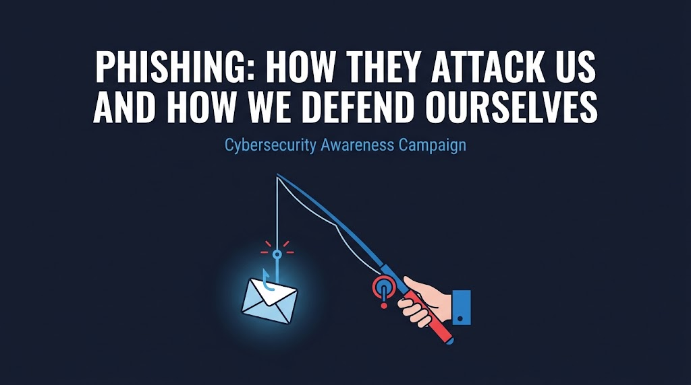

**Phishing: How They Attack Us and How We Defend Ourselves**
*Cybersecurity Awareness Campaign*

---

## Slide 2 — What Is Phishing?

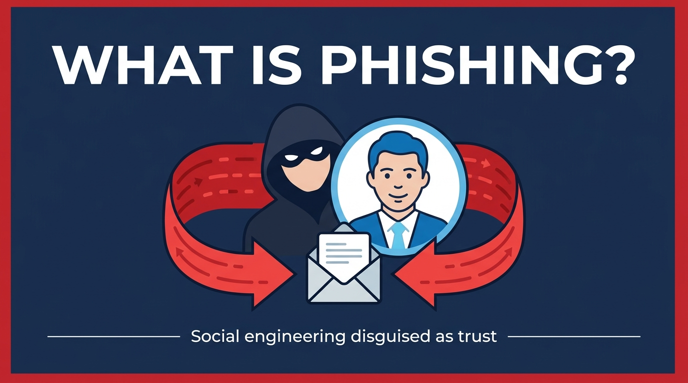

Social engineering disguised as trust. *(See `01-what-is-phishing.md`)*

---

## Slide 3 — Why Phishing Matters

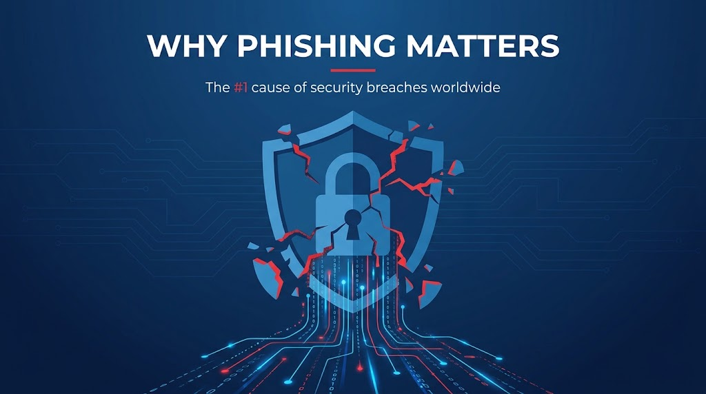

The #1 cause of security breaches worldwide. *(See `02-why-phishing-matters.md`)*

---

## Slide 4 — Types of Phishing

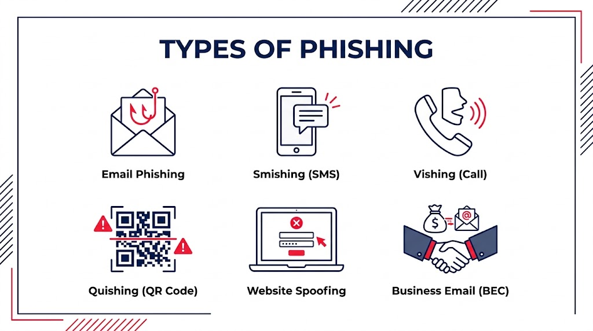

Email, Smishing, Vishing, Quishing, Website Spoofing, BEC. *(See `03-types-of-phishing.md`)*

---

## Slide 5 — How a Phishing Attack Works

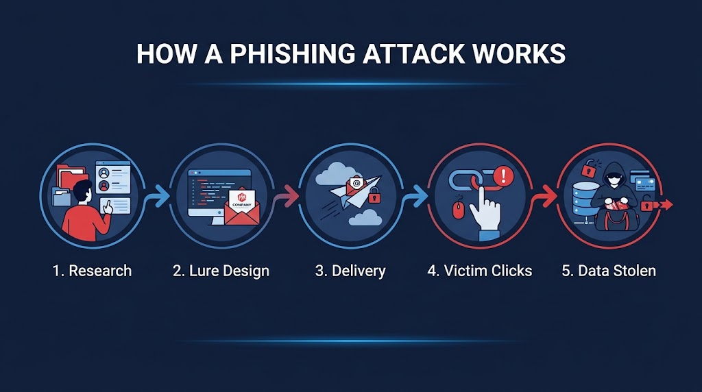

Research → Lure Design → Delivery → Victim Clicks → Data Stolen. *(See `04-how-phishing-attacks.md`)*

---

## Slide 6 — What Phishing Exploits

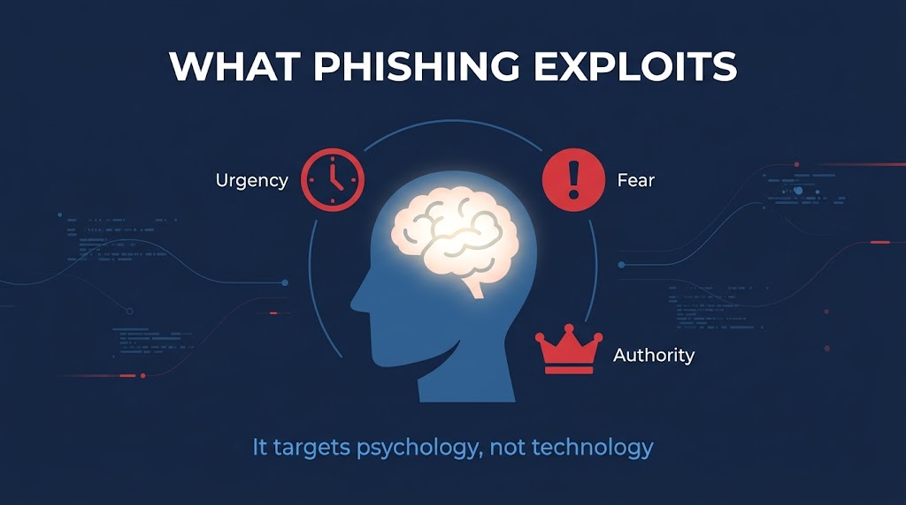

It targets psychology, not technology: urgency, fear, authority. *(See `05-what-phishing-exploits.md`)*

---

## Slide 7 — Why Everyone Is Vulnerable

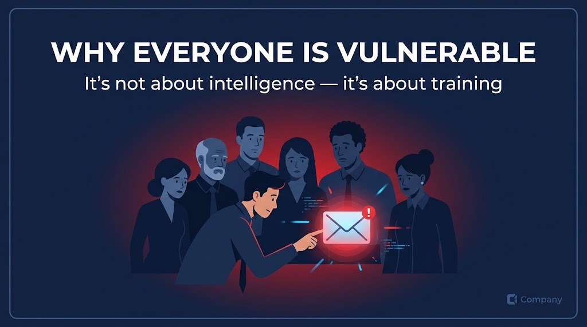

It's not about intelligence — it's about training. *(See `06-why-everyone-is-vulnerable.md`)*

---

## Slide 8 — Spot the Red Flags

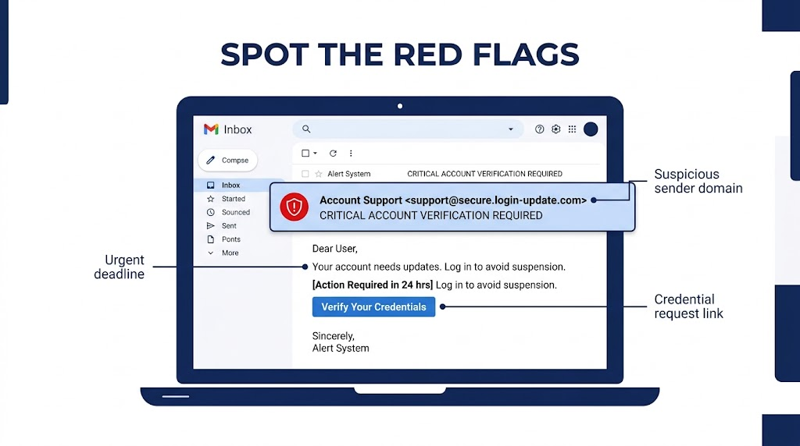

Suspicious sender domain, urgent deadline, credential request link. *(See `07-simulated-phishing-examples.md`)*

---

## Slide 9 — Campaign Results by Department

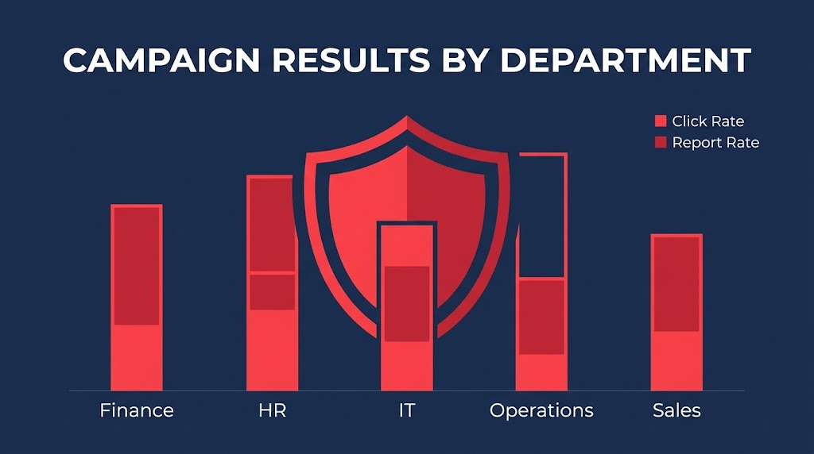

Click rate vs. report rate, broken down by department. *(See `08-campaign-results-and-department-risk.md`)*

---

## Slide 10 — HR vs. Finance: Different Risks

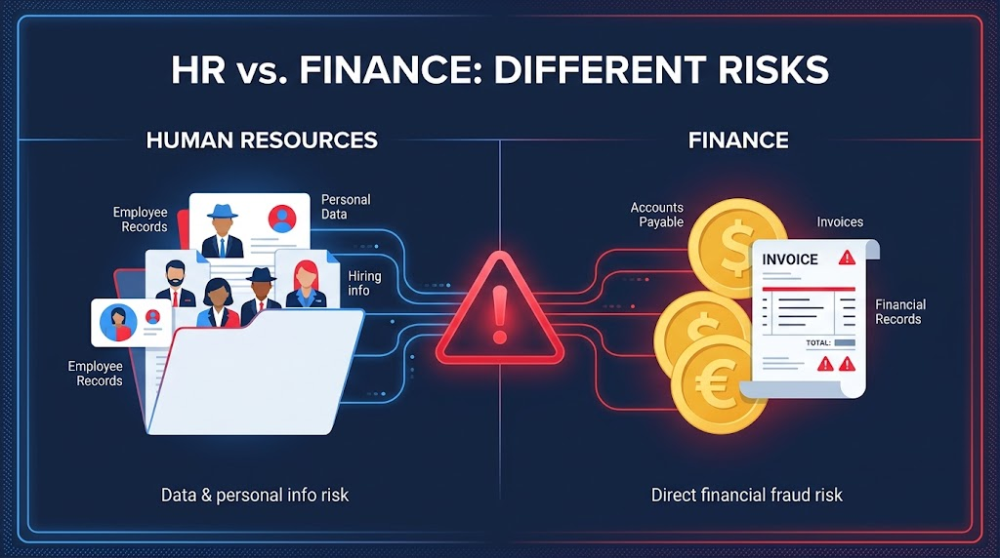

Data & personal info risk vs. direct financial fraud risk. *(See `08-campaign-results-and-department-risk.md`)*

---

## Slide 11 — How to Prevent Phishing

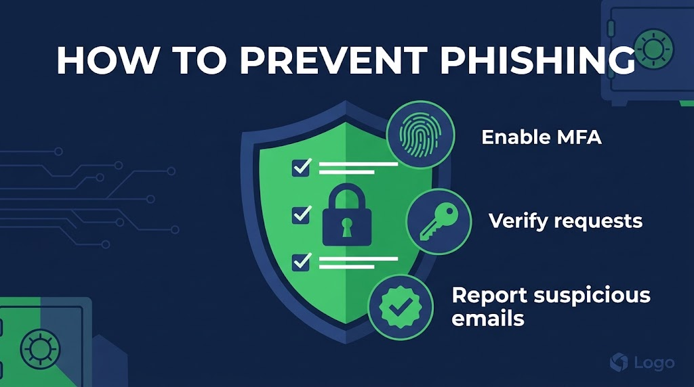

Enable MFA, verify requests, report suspicious emails. *(See `09-prevention-and-response.md`)*

---

## Slide 12 — Stop. Think. Verify. Report.

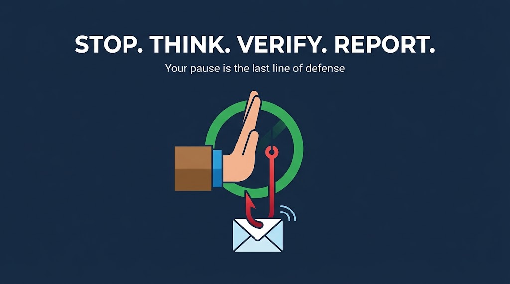

Your pause is the last line of defense.

---

## Slide 13 — About the Presenter

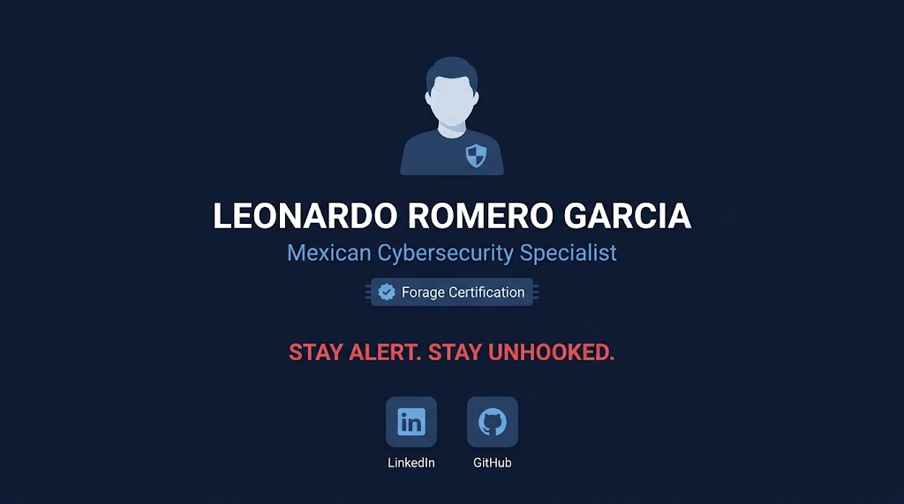

**Leonardo Romero García**
*Mexican Cybersecurity Specialist — Forage Certification*

**"Stay Alert. Stay Unhooked."**

🔗 [LinkedIn](https://www.linkedin.com/in/leoromerog/)
🔗 [GitHub](https://github.com/ravesnoopy)

---

*Educational cybersecurity awareness project. All example data and phishing templates referenced throughout this presentation are fictitious and were created strictly for training purposes.*
